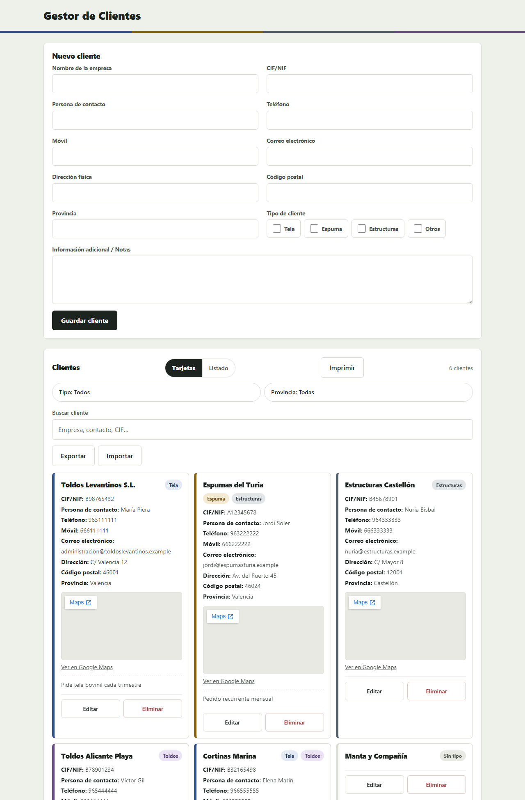

# Gestor de Clientes


[](https://carlosarnu.github.io/gestor-de-clientes/)

Aplicación para que un comercial autónomo gestione sus clientes —empresa, CIF, contacto, teléfono, email, dirección, provincia, varios tipos de cliente y notas— con **todo guardado en tu propio navegador**. Funciona abriendo `index.html` con doble clic, sin servidor ni instalación, y se empaqueta opcionalmente como app de escritorio con Electron.

[▶️ **Probar la demo en vivo**](https://carlosarnu.github.io/gestor-de-clientes/) · sin registro, sin backend, tus datos nunca salen de tu equipo.



> 📸 Los clientes de la captura son ficticios, creados para la demo.

## ✨ Características

| | |
|---|---|
| 🗂️ **Ficha completa** | 14 campos por cliente: empresa, CIF, contacto, teléfono, móvil, email, dirección, código postal, provincia, tipos y notas. **Ninguno es obligatorio** |
| 🏷️ **Varios tipos a la vez** | Un cliente puede ser de **Tela y Espuma** a la vez, con tipos propios libres («Toldos», «Lona»…) además de los fijos |
| 🔍 **Búsqueda instantánea** | Filtra en vivo mientras escribes; todas las palabras, repartidas entre los campos, sin importar acentos ni mayúsculas |
| 🎛️ **Filtros múltiples** | Dos desplegables con casillas —**Tipo** (intersección «y») y **Provincia** (unión «o»)— combinados con la búsqueda |
| 🗺️ **Mapa en la ficha** | Google Maps incrustado con la dirección, sin necesidad de API key |
| 🖨️ **Impresión y PDF** | Vista previa de la hoja de papel, imprimir lo que se ve y guardar como PDF (en la app de escritorio) |
| 📋 **Vista de listado** | Conmuta entre tarjetas y filas compactas con solo los campos que elijas |
| 💾 **Copia de seguridad** | Exporta e importa tus clientes como JSON; nada se pierde |
| 🖥️ **App de escritorio** | Empaquetado con Electron: ventana propia, datos en `Documentos\Gestor de Clientes\clientes.json` |

## 🚀 Uso rápido

**Web (recomendado):** descarga el repositorio y abre `index.html` con doble clic. No necesita servidor, build ni dependencias.

**App de escritorio (opcional):**

```bash
cd escritorio
npm install
npm start        # arranca la app
npm run build    # genera el instalador NSIS
```

## 🧱 Tecnologías

- **HTML5 + CSS3 + JavaScript puros** — sin frameworks, sin bundler, sin build.
- **`localStorage`** — los clientes viven en tu navegador bajo una única clave (`gestorClientes`).
- **Electron** (solo como *devDependency*, en `escritorio/`) — para la app de escritorio.
- **`node --test`** — tests de la lógica con el runner nativo de Node.

## 🗂️ Estructura

```
gestor-de-clientes/
├── index.html            # Interfaz
├── styles.css            # Estilos
├── app.js                # Interfaz, eventos y estado
├── logica.js             # Lógica pura (sin DOM ni localStorage) — todo lo testeable
├── hoja-impresion.css    # Hoja de impresión y vista previa
├── test-*.js             # Tests con node --test
├── escritorio/           # Embudo opcional de Electron
├── specs/                # Especificaciones (Spec-Driven Development)
└── docs/                 # Constitución y documentación
```

## 🧪 Tests

```bash
node --test
```

La lógica pura vive separada de la interfaz (`logica.js`, sin DOM ni `localStorage`) para que se pueda probar en frío. Los tests cubren filtrado, búsqueda, tipos múltiples, provincias, estados vacíos, nombres de archivo PDF, impresión y más.

## 🔒 Privacidad

- **Tus datos no salen de tu equipo.** Todo se guarda en `localStorage` de tu propio navegador o, en la app de escritorio, en un JSON local de tus Documentos.
- **Sin cuentas, sin analytics, sin peticiones a servidores propios.** El único recurso externo es el iframe de Google Maps en la ficha, que solo se carga si introduces una dirección.

## 🤖 Desarrollo asistido con agentes de IA

Este proyecto se ha desarrollado con **agentes de IA** como parte del flujo de trabajo, siguiendo **Spec-Driven Development**: cada funcionalidad se especifica primero (`specs/`), después se planifica y por último se implementa.

- **El agente de IA** se encarga de la implementación a partir de la especificación y de escribir y ejecutar los tests.
- **Carlos Arnanz** define los requisitos, toma las decisiones de diseño y de modelo de datos, revisa cada cambio y valida el resultado final.
- Las decisiones quedan documentadas en `MEMORY.md` y las reglas permanentes en `AGENTS.md` y `docs/constitution.md`.

## 📄 Licencia

MIT

## 👤 Autor

**Carlos Arnanz** — [github.com/carlosarnu](https://github.com/carlosarnu)
